# Bump'em Physical Edition Project Summary

## 1. Confirmed Deck Composition (Empirical Reverse Engineering)

Total deck size: 54 tickets

- 5 × 1
- 4 × 2–11
- 5 × 12
- 4 × BUMP'EM

Reshuffle occurs when deck is exhausted.

## 2. Confirmed Ticket Rules (From In‑Game UI)

Exact wording captured from screenshots.

| Ticket | Wording |
|--------|--------|
| **1** | Move a car from pit row to your start space **OR** move a car on the track one space forward. |
| **2** | Move a car on the track two spaces forward. |
| **3** | Move a car on the track three spaces forward **AND** take another move ticket. |
| **4** | Move a car on the track four spaces forward. |
| **5** | Move a car on the track five spaces forward. |
| **6** | Move a car on the track six spaces forward **OR** nine spaces backward. |
| **7** | Move a car on the track seven spaces forward **OR** switch one of your cars with another player's car. |
| **8** | Move a car on the track eight spaces forward **OR** split the move between two cars. |
| **9** | Move a car on the track nine spaces forward **OR** six spaces backward. |
| **10** | Move a car on the track ten spaces forward. |
| **11** | Move a car on the track eleven spaces forward **OR** one space backward. |
| **12** | Move a car from pit row to your start space **OR** move a car on the track twelve spaces forward. |
| **BUMP'EM** | Take a car from your pit row and bump another player's car. |

## 3. Board Layout Requirements

- 4 quadrants
- 48 outer track spaces
- 4 pit rows (4 cars each)
- 4 home stretches (5 spaces each)
- 4 TURBO spaces
- 4 OIL SLICK spaces
- Directional arrows on track

## 4. Components To Build

- Authentic 54-card poker deck
- Full printable board (multi-page tile or poster format)
- 16 printable car standees (4 each: red, green, blue, yellow)
- Oil slick & turbo markers
- Compact printable rule sheet

## 5. Source Screenshots

**Board**

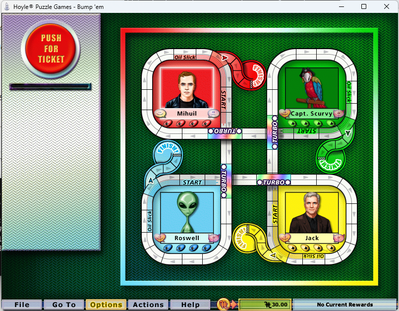

**Tickets 1–12 & BUMP'EM**

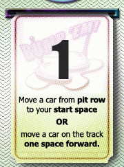 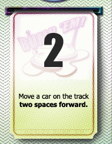 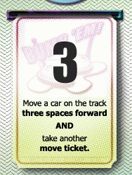 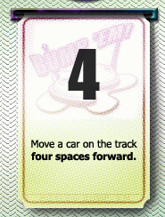 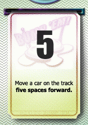 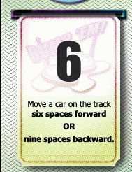 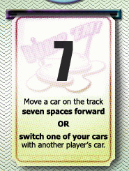 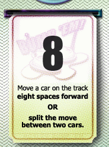 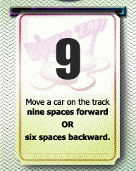 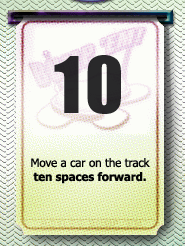 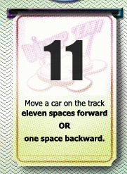 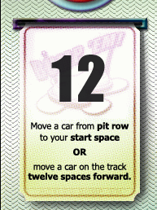 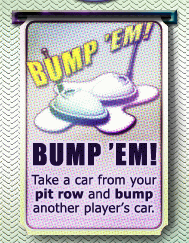
